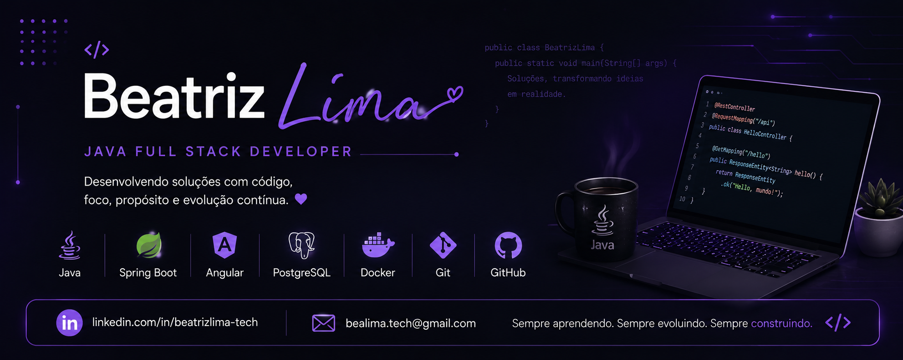

  

<h1 align="center">Beatriz Lima</h1>

  <strong>Desenvolvedora Java Full Stack • Spring Boot • Angular • APIs REST</strong>

  

---

# 👩‍💻 Sobre mim

🎓 Tecnóloga em Gestão da Tecnologia da Informação.

🔐 Atualmente cursando o Certificado Profissional de Cibersegurança do Google.

☕ Desenvolvedora Java Full Stack com foco em back-end, APIs REST e aplicações desenvolvidas com Spring Boot.

🚀 Tenho vivência prática na construção de projetos com arquitetura em camadas, regras de negócio, persistência de dados, autenticação, integração entre sistemas e testes automatizados.

---

# 🛠️ Tecnologias e ferramentas

<h3 align="center">💻 Desenvolvimento</h3>

  

<h3 align="center">⚙️ Ferramentas e infraestrutura</h3>

  

  
  
  
  

---

# 📚 Atualmente estudando

- Cibersegurança
- Spring Security
- JWT
- RabbitMQ
- MongoDB
- Docker
- Arquitetura de microsserviços
- Testes automatizados
- Inteligência Artificial aplicada ao desenvolvimento

---

# ⭐ Projetos em destaque

### 💰 API Finanças

API REST desenvolvida com Java e Spring Boot para gerenciamento de categorias, receitas e despesas.

O projeto possui CRUD completo, consulta de movimentações por período, paginação, validações de negócio, tratamento de exceções, documentação com Swagger e testes automatizados com JUnit, MockMvc e H2.

🔗 **[Acessar API Finanças](https://github.com/beatrizlima-tech/api-financas)**

---

### 🔐 API Autenticação 

API REST desenvolvida com Java e Spring Boot para cadastro e autenticação de usuários.

O projeto inclui geração de token JWT, criptografia de senhas, validações de negócio, persistência com MySQL, documentação com Swagger e ambiente configurado com Docker Compose.

🔗 **[Acessar API Autenticação](https://github.com/beatrizlima-tech/api-autenticacao)**

---

### 💻 Web Finanças

Aplicação frontend desenvolvida com Angular para cadastro e autenticação de usuários.

O projeto utiliza Reactive Forms, validações personalizadas, Bootstrap, HttpClient e integração com uma API REST desenvolvida em Spring Boot.

🔗 **[Acessar Web Finanças](https://github.com/beatrizlima-tech/web-financas)**

---

### 📦 API Pedidos

API desenvolvida com Java e Spring Boot para gerenciamento e processamento de pedidos.

O projeto utiliza MongoDB, RabbitMQ, processamento assíncrono, comunicação entre serviços e documentação com Swagger/OpenAPI.

🔗 **[Acessar API Pedidos](https://github.com/beatrizlima-tech/api-pedidos)**

---

# 📂 Outros projetos

- 🔗 [API Clientes](https://github.com/beatrizlima-tech/api-clientes)
- 🔗 [Web Clientes](https://github.com/beatrizlima-tech/web-clientes)
- 🔗 [API Produtos](https://github.com/beatrizlima-tech/produtos-api)
- 🔗 [Web Produtos](https://github.com/beatrizlima-tech/web-produto)
- 🔗 [Projeto CRUD](https://github.com/beatrizlima-tech/projetoCrud)
- 🔗 [Projeto Agenda](https://github.com/beatrizlima-tech/projetoAgenda)
- 🔗 [Sistema de Pedidos](https://github.com/beatrizlima-tech/sistemaDePedidos)

➡️ **[Ver todos os repositórios](https://github.com/beatrizlima-tech?tab=repositories)**

---

# 🌎 Onde me encontrar

  

  

# 📊 GitHub Stats

<h3 align="center">💻 Linguagens mais utilizadas</h3>

  

<h3 align="center">📈 Estatísticas do GitHub</h3>

  

