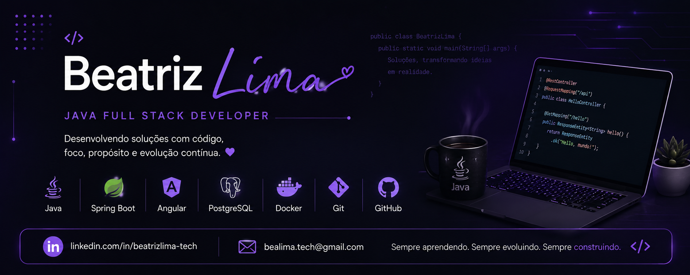

  

<h1 align="center">Olá, eu sou Beatriz Lima 👋</h1>

  <strong>Desenvolvedora Java Back-end | Spring Boot | Angular | APIs REST</strong>

  Desenvolvendo aplicações Full Stack com foco em regras de negócio, APIs, testes e código de fácil manutenção.

  <a href="./README.md">🇺🇸 English</a> · <a href="./README.pt-BR.md">🇧🇷 Português</a>

  
  
  

---

## 👩‍💻 Sobre mim

Sou desenvolvedora brasileira, formada em **Gestão da Tecnologia da Informação** e atualmente cursando o bacharelado em **Sistemas de Informação**.

Meu foco principal é o **desenvolvimento Back-end com Java**, especialmente **Spring Boot, APIs REST, bancos de dados, regras de negócio e testes automatizados**. Também trabalho com **Angular e TypeScript**, integrando APIs a interfaces funcionais.

Em projetos acadêmicos e colaborativos, tive contato prático com arquitetura em camadas, autenticação JWT, bancos de dados SQL e NoSQL, mensageria assíncrona e integrações entre sistemas. Também estou aprofundando meus conhecimentos em **cibersegurança** e no uso responsável de **inteligência artificial em aplicações**.

🎯 **Objetivo profissional:** oportunidades como desenvolvedora Java Back-end ou Full Stack Júnior, incluindo estágios.

## 🛠️ Tecnologias e ferramentas

**Desenvolvimento**

  

**Ferramentas e infraestrutura**

  

JUnit · Mockito · MockMvc · Vitest · Swagger / OpenAPI · Spring Security · JWT · Flyway

## ⭐ Projetos em destaque

### 📦 Gestão de Produtos — Java + Angular

Aplicação Full Stack para gerenciamento de produtos e estoque, com indicadores e uma **Lixeira**. Os produtos podem ser excluídos logicamente, restaurados em até **30 dias** ou removidos definitivamente.

O backend possui uma rotina agendada para limpeza de registros expirados, enquanto a interface Angular oferece validações, confirmações e mensagens de retorno ao usuário.

**Tecnologias:** Java, Spring Boot, PostgreSQL, Flyway, Angular 21, TypeScript, JUnit e Vitest.

**Destaques:** integração com API REST · regras de negócio · **35 testes Angular aprovados** · carregamento de rotas sob demanda.

🔗 [Repositório do backend](https://github.com/beatrizlima-tech/gestao-produtos-api) · [Repositório do frontend](https://github.com/beatrizlima-tech/gestao-produtos-web)

### 💰 Plataforma de Finanças Pessoais — APIs + Angular + IA

Conjunto integrado de aplicações para gerenciamento de finanças pessoais, incluindo cadastro e autenticação com JWT, controle de receitas e despesas, isolamento de dados por usuário e processamento assíncrono de relatórios financeiros.

Um serviço interno de inteligência artificial realiza integração com OpenAI, MongoDB e envio de relatórios por e-mail.

**Tecnologias:** Java, Spring Boot, Spring Security, PostgreSQL, MySQL, MongoDB, RabbitMQ e Angular 21.

🔗 [API Finanças](https://github.com/beatrizlima-tech/api-financas) · [API Autenticação](https://github.com/beatrizlima-tech/api-autenticacao) · [API Agentes IA](https://github.com/beatrizlima-tech/api-agentesia) · [Frontend Angular](https://github.com/beatrizlima-tech/web-financas)

### 📦 API Pedidos — RabbitMQ

API desenvolvida com Spring Boot para gerenciamento de clientes, produtos e pedidos. Utiliza MongoDB para persistência e RabbitMQ para processamento assíncrono.

**Tecnologias:** Java, Spring Boot, MongoDB, RabbitMQ, Spring AMQP e Swagger / OpenAPI.

🔗 [API Pedidos](https://github.com/beatrizlima-tech/api-pedidos) · [API Pagamentos](https://github.com/beatrizlima-tech/api-pagamentos)

### 🍰 DoceGestão — Em desenvolvimento

Projeto em evolução voltado à gestão financeira e operacional de pequenos negócios de confeitaria, inspirado em necessidades reais do dia a dia de empreendedores.

🔗 [Backend](https://github.com/beatrizlima-tech/DoceGestao-backend) · [Frontend](https://github.com/beatrizlima-tech/DoceGestao-frontend)

> Alguns projetos foram desenvolvidos em colaboração com colegas durante cursos e atividades de formação.

## 📚 Atualmente estudando

- Java, Spring Boot, Angular e testes de software.
- Fundamentos de cibersegurança e desenvolvimento seguro.
- Arquitetura de software, integração de sistemas e aplicações com inteligência artificial.

## 📫 Vamos nos conectar?

Busco oportunidades de estágio e desenvolvimento de software Júnior, especialmente nas áreas de **Java Back-end e Full Stack**.

[LinkedIn](https://www.linkedin.com/in/beatrizlima-tech) · [E-mail](mailto:bealima.tech@gmail.com) · [Todos os repositórios](https://github.com/beatrizlima-tech?tab=repositories)

📊 Estatísticas do GitHub

  
  

